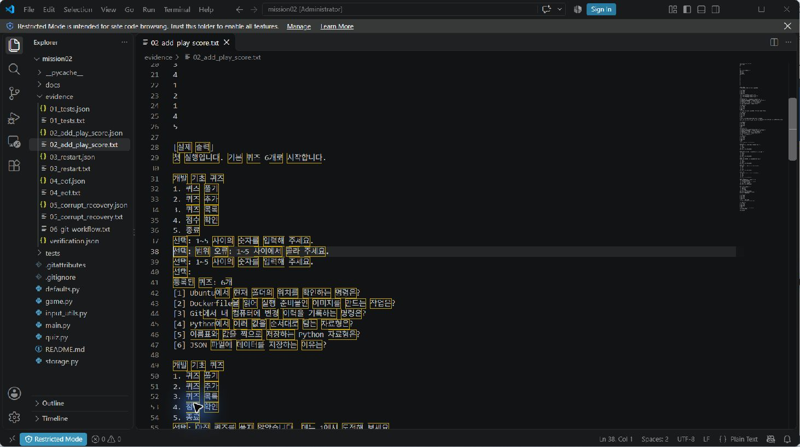
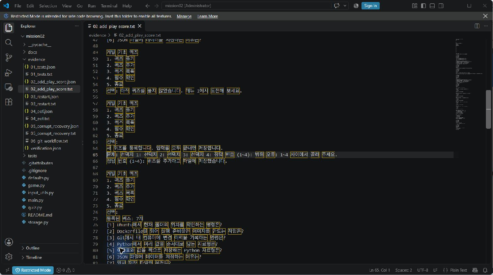
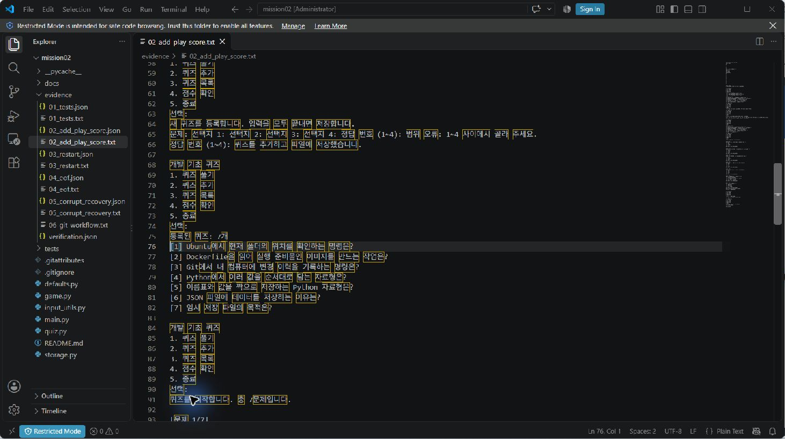
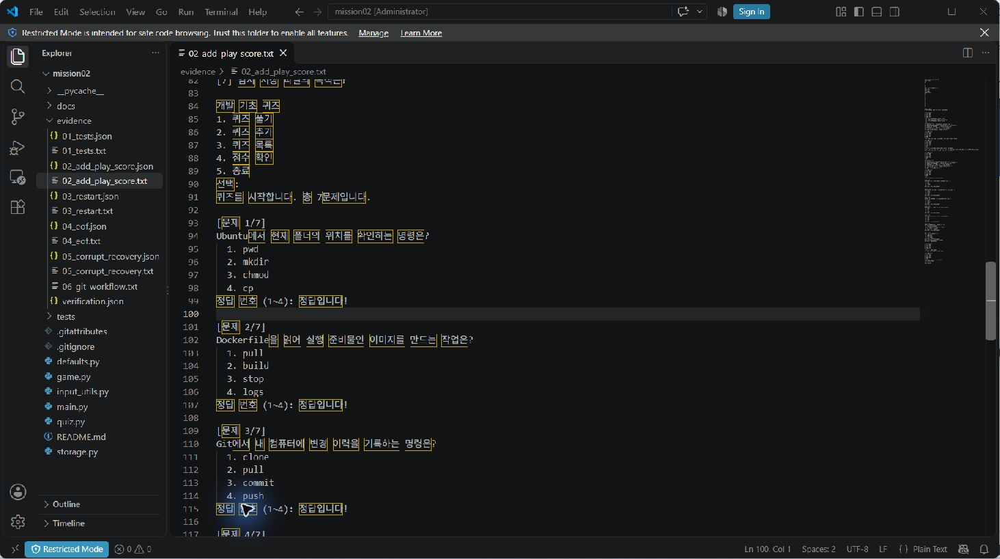
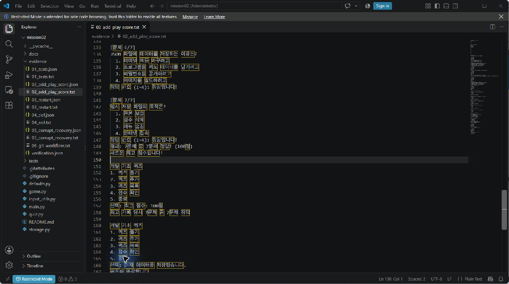
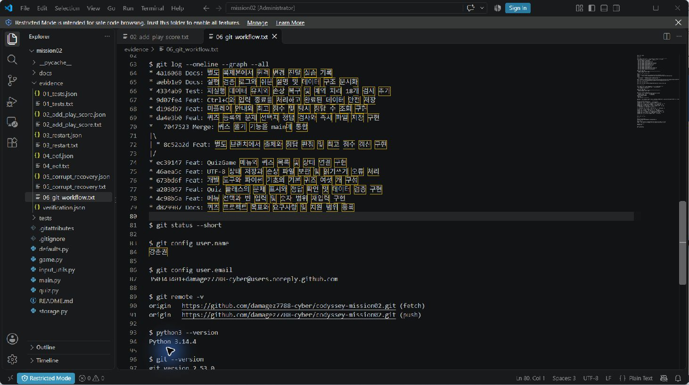

# 강준권의 개발 기초 퀴즈

제출자: **강준권**

2026-11-14 사전평가 보완: [18개 항목별 확인 위치](#8-사전평가-보완과-재검증-2026-11-14),
[커밋 근거·규칙](#9-실제-커밋-수-브랜치-커밋-작성-규칙),
[대규모 실측·대안](#13-1000문제-이상-성능메모리검색과-확장-대안),
[요구 변경별 수정 위치](#14-요구사항이-바뀔-때-고칠-곳).

코디세이 미션 2인 ‘컴퓨터에게 명령 내리는 말(파이썬) 처음 배우기’의 프로젝트입니다.
개발 도구와 파이썬 기초를 문제로 구성해, 배운 용어를 복습할 수 있게 만듭니다.

Python의 변수·조건·반복·함수·클래스·파일 입출력을 하나의 동작하는 프로그램으로 연결하는 것이 목표입니다.
Python 3.10 이상과 표준 라이브러리만 사용합니다. 최초 검증은 WSL Ubuntu / Python 3.14.4,
2026-11-14 보완 검증은 Windows 11 / Python 3.12.14에서 수행했습니다. 환경별 로그는 5절과 8절에 있습니다.

## 1. 실행 방법

VS Code에서 이 프로젝트 폴더를 열고 Ubuntu 터미널에서 실행합니다.

```bash
python3 --version
python3 main.py
```

첫 명령은 Python 버전 확인, 둘째는 `main.py`에서 퀴즈 게임을 시작하는 명령입니다.
Windows에서 Python 3.10 이상이 설치되어 있으면 `python main.py`로도 실행할 수 있습니다.
외부 패키지 설치는 필요 없습니다. 첫 실행에는 기본 6문제를 불러옵니다.

```text
1. 퀴즈 풀기
2. 퀴즈 추가
3. 퀴즈 목록
4. 점수 확인
5. 종료
```

위 메뉴는 사용 순서 안내입니다. 실제 명령과 입력·출력 전체는 아래 검증 링크에 있습니다.
숫자를 입력하고 Enter를 누릅니다. 빈 입력·문자·범위 밖 숫자면 같은 질문으로 돌아갑니다.
추가 메뉴에서는 문제, 선택지 4개, 정답 번호 1~4를 차례로 입력합니다.
문제 풀이가 끝나면 `정답 수 / 전체 수 × 100`을 반올림한 점수를 표시합니다.
최고 점수는 백분율로 비교하며, 그 점수를 얻은 당시의 정답 수와 전체 문제 수도 함께 보관합니다.
동점이면 기존 최고 기록을 유지합니다. 미플레이와 0점으로 플레이한 경우는 구분합니다.

## 2. 주제 선정 이유와 기능

주제는 개발 도구와 파이썬 기초입니다. `pwd`, Docker build, Git commit, list/dict, 파일 저장을 문제로 구성했습니다.
개발 환경 실습에서 배운 용어를 퀴즈로 다시 떠올리고, 코드 속 데이터와 연결해 설명하기 위함입니다.

| 기능 | 확인할 동작 |
|---|---|
| 풀기 | 저장된 모든 퀴즈 출제, 정답·오답 안내, 결과 및 최고 점수 갱신 |
| 추가 | 문제·4개 선택지·정답 번호 검사, 완성된 문제만 등록하고 즉시 저장 |
| 목록 | 등록 문제 제목 표시, 빈 목록 안내 |
| 점수 | 미플레이 안내 또는 최고 점수와 당시 정답 수 표시 |
| 종료 | 완료된 내용 저장. Ctrl+C와 EOF도 안내 후 안전 종료 |
| 파일 오류 | 없는 파일은 기본값, 손상 파일은 원본 별도 보관 후 복구 |

## 3. 파일 구조와 코드 흐름

```text
main.py          게임 시작, Ctrl+C/EOF 처리
game.py          QuizGame: 메뉴, 풀기, 추가, 목록, 점수
quiz.py          Quiz: 문제 하나, 선택지, 정답 검사
input_utils.py   숫자·빈 입력 재시도
defaults.py      기본 퀴즈 6개
storage.py       state.json 읽기/저장, 오류 복구
state.json       실행 중 자동 생성되는 개인 퀴즈/기록
tests/           임시 폴더를 쓰는 기능 검사
evidence/        실제 명령·입력·출력과 검사 결과
docs/            요구사항 및 지원 범위
```

`main.py → QuizGame → 메뉴별 메서드 → Quiz / StateStore` 순서로 연결됩니다.
Quiz는 개별 문제, QuizGame은 게임 진행, StateStore는 파일 저장의 책임을 가집니다.
`__init__`은 객체를 처음 만들 때 속성을 준비하고, `self`는 그 객체 자신의 상태를 가리킵니다.
`list`에 퀴즈들을 담고, `dict`로 JSON에 저장할 이름과 값을 묶습니다.
메뉴와 재입력은 `while`, 정해진 퀴즈·선택지 순회는 `for`, 정답 분기는 `if`를 사용합니다.

## 4. state.json 설명

위치는 **이 프로젝트 루트**입니다. 다른 폴더에서 `main.py`를 실행해도 이 파일 위치를 유지합니다.
UTF-8로 한글을 그대로 저장합니다. 최초 실행 시 파일이 없으면 기본 문제를 쓰고, 저장할 때 파일을 만듭니다.

```json
{
  "quizzes": [{"question": "예시 문제", "choices": ["가", "나", "다", "라"], "answer": 1}],
  "best_score": 100,
  "played": true,
  "best_result": {"correct": 1, "total": 1}
}
```

위 JSON은 필드 설명용 예시이며 검증 당시의 기록 자체는 아닙니다.
`quizzes`는 문제 목록, `best_score`는 최고 백분율 점수, `played`는 풀이 경험 여부입니다.
`best_result`는 최고 기록 당시의 정답/전체 문제 수이며 미플레이 때는 null입니다.
실행 데이터 `state.json`은 `.gitignore`로 Git 기록에서 제외해 개인 연습 기록을 공유하지 않습니다.
손상 복구 시 `state.corrupt-날짜.json`에 원본을 남깁니다. 원본 보관에 실패하면 덮어쓰기를 막습니다.
새 내용은 임시 파일에 쓴 뒤 교체하여 저장 실패가 기존 정상 파일을 바로 망가뜨리지 않게 했습니다.
저장 실패 시 화면에 알리며 메모리 내용과 파일 저장 성공을 구분합니다.

## 5. 실제 실행 검증

검증일: 2026-11-05. 지원 도구가 Ubuntu에서 실행했습니다. 증거는 명령, 입력, stdout/stderr, 종료 코드를 포함합니다.

| 항목 | 실제 증거 |
|---|---|
| 기능 검사 18개 통과 | [검사 로그](evidence/01_tests.txt) |
| 잘못된 입력, 추가, 목록, 전체 정답, 100점 | [실행 로그](evidence/02_add_play_score.txt) |
| 별도 프로세스 재실행 후 7문제와 100점 유지 | [재실행 로그](evidence/03_restart.txt) |
| 입력 스트림 종료(EOF) 안전 종료 | [EOF 로그](evidence/04_eof.txt) |
| 손상 JSON 원본 보관과 기본 데이터 복구 | [복구 로그](evidence/05_corrupt_recovery.txt) |
| 실행 환경과 검증 요약 | [검증 JSON](evidence/verification.json) |

`OK`는 자동 검사가 통과했다는 뜻이고, `exit_code=0`은 실행이 정상 종료됐다는 뜻입니다.
퀴즈 추가·재실행 검증은 프로젝트의 임시 복사본에서 진행해 제출 폴더의 기본 상태를 오염시키지 않았습니다.
Ctrl+C, 쓰기 실패, 복구용 원본 보관 실패는 unittest에서 해당 예외를 주입해 확인했으며, 실제 사용자 비밀번호를 입력하는 실험은 아닙니다.

### 실행 결과 화면

다음은 **위 실제 실행 로그를 VS Code에서 열어 캡처한 화면**입니다. 방금 터미널에 직접 입력 중인 화면으로 표시하지 않습니다.
명령과 입력의 원문은 텍스트/JSON 로그에서 확인하고, 화면은 출력 결과를 읽기 쉽게 확인하는 보조 증거로 사용합니다.







## 6. Git 이력과 협업 실습

기능별로 실제 소스를 변경하며 기록했습니다. 퀴즈 풀기는 `codex/quiz-play`에서 개발하고 `main`으로 병합했습니다.

```bash
git log --oneline --graph --all
git status
```

첫 명령은 커밋과 브랜치의 연결 구조, 둘째는 아직 기록하지 않은 변경을 확인합니다.
파일 저장은 파일 내용 반영, `git add`는 다음 기록에 담을 변경 선택, `git commit`은 로컬 이력,
`git push`는 원격 GitHub로 이력을 올리는 동작입니다. `clone`은 별도 복제, `pull`은 기존 작업 폴더로 최신 변경을 가져옵니다.

[실제 복제·가져오기 로그](evidence/06_git_workflow.txt)에서 `git clone` → 복제본 README 수정·commit·push → 원래 폴더의 `git pull --ff-only` → 문장 반영 확인을 볼 수 있습니다.
`--ff-only`는 이력이 갈라져 있으면 임의 병합하지 않고 중단하는 옵션입니다.
로그의 `Fast-forward`는 원격의 새 커밋을 순서대로 가져와 작업 폴더를 갱신했다는 뜻입니다.
같은 로그에 브랜치 병합 그래프, Git 작성자, 원격 주소, Python/Git 버전이 있습니다.



## 7. 평가에서 설명하기

“기본 퀴즈를 Quiz 객체로 만들고, QuizGame이 메뉴와 풀이를 관리합니다.
입력을 검사한 다음 정답 수를 점수로 바꾸고, JSON에 추가 문제와 최고 점수를 저장합니다.
재실행 검증은 실제로 다른 프로세스를 실행해 저장된 7문제와 100점이 다시 보이는 것을 확인했습니다.”

플랫폼 평가의 통과 여부와 프로그램 검사 통과는 별도입니다. 평가 신청은 이번 작업에 포함하지 않습니다.

코드 작성 및 실행 검증에는 AI 도구를 활용합니다. [작성·실행 지원 범위](docs/support.txt)를 참고하세요.

복제 실습 확인: 별도 복제본에서 이 문장을 기록하고 push한 뒤 원래 작업 폴더에서 pull로 확인했습니다.

## 8. 사전평가 보완과 재검증 (2026-11-14)

사전평가 18개 항목 중 실패 4개와 통과 항목의 보완 의견을 아래 위치에 연결했습니다.
기존 핵심 기능은 유지하고 설명·검증 근거를 보강했습니다. 이 문서의 보완 완료와 플랫폼의 최종 통과는 별개입니다.

| 평가 번호 | 보완한 내용과 확인 위치 |
|---|---|
| 1 | 메뉴 통합 실행, Python·OS·종료 코드: [새 기능 검사](evidence/precheck_20261114/01_tests.txt), [CLI 실행](evidence/precheck_20261114/02_cli.txt) |
| 2 | 입력 오류 안내의 공통 형식: 10절 입력 검사 표 |
| 3 | 별도 프로세스에서 7문제·100점 유지: 새 CLI 실행 로그. 동시 실행 정책: 12절 |
| 4 | 기본 6문제의 추가·수정 방법: 10절 |
| **5 (FAIL)** | **실제 HEAD의 커밋 15개**, 개수 명령·전체 목록: 9절 및 [Git 근거](evidence/precheck_20261114/04_git_history.txt) |
| 6 | `main`과 `codex/quiz-play`의 목적, 실제 병합 커밋: 9절 |
| 7 | 5절의 화면별 캡션, 아래 파일명·내용 표, 6절의 Git 환경 화면 |
| 8 | 클래스별 주요 공개 메서드와 역할: 10절 |
| 9 | 입력·진행·저장 분리 이유: 10절 |
| 10 | 임시 파일 생성 → 쓰기 → 닫기 → 교체 순서와 한계: 11절 |
| 11 | Ctrl+C/EOF와 SIGTERM·강제 종료의 처리 범위: 12절 |
| **12 (FAIL)** | **커밋 단위 규칙·메시지 템플릿**: 9절 |
| 13 | `Quiz`를 메뉴 밖에서 재사용하는 예시: 10절 |
| 14 | JSON 필드의 필수 여부·타입·검사 범위: 11절 |
| 15 | 읽기·쓰기 권한 오류의 복구 순서: 12절 |
| **16 (FAIL)** | **1,000·10,000문제 실측 성능·메모리·검색 및 확장 대안**: 13절 |
| 17 | 손상 원본 보관과 수동 정리 정책: 12절 |
| **18 (FAIL)** | **요구 변경별 파일·메서드·저장 필드·검사 매핑**: 14절 |

실제 추가 검증 환경은 **Windows-11-10.0.26300-SP0 / AMD64 / Python 3.12.14**입니다.
기존 자동 검사 **18개 통과**, 실제 CLI 프로세스에서 잘못된 입력·추가·목록·7문제 풀이·100점 조회,
재실행 유지, EOF 종료, 손상 원문 보관과 기본 6문제 복구를 확인했습니다.
[기계 판독용 종합 결과](evidence/precheck_20261114/verification.json)에 실제 시각과 코어 파일·개인 상태의 SHA-256을 남겼습니다.
검증 중 기존 6개 코어 파일과 루트 `state.json`의 변경 여부를 전후 해시로 비교했고 변경되지 않았습니다.

다시 검사하려면 프로젝트 루트의 Ubuntu 터미널에서 다음을 실행합니다.

```bash
python3 scripts/verify_submission.py --output evidence/precheck_local
```

전체 뜻은 “검증 프로그램을 실행하고 결과를 지정한 폴더에 저장”입니다.
`scripts/verify_submission.py`는 검사 파일, `--output`은 로그를 둘 위치입니다.
Windows에서는 설치된 Python으로 `python scripts/verify_submission.py --output evidence/precheck_local`을 사용합니다.
성공하면 결과 폴더·실행 환경·규모별 수치가 출력되고 정상 종료 코드 0을 반환합니다.
실패하면 예외와 함께 0이 아닌 코드로 끝납니다. 수치는 컴퓨터와 실행 시점에 따라 달라집니다.
테스트용 추가 문제와 손상 파일은 임시 폴더에서만 생성합니다.

| 기존 화면 파일 | 캡션·보여 주는 내용 |
|---|---|
| `docs/screenshots/menu.png` | 실제 실행 로그의 메뉴 및 재입력 안내 |
| `docs/screenshots/add_quiz.png` | 문제·4개 선택지·정답을 등록하고 저장한 로그 |
| `docs/screenshots/list.png` | 추가 후 7개 문제 목록 |
| `docs/screenshots/play.png` | 출제·정답 판정 결과 |
| `docs/screenshots/score.png` | 최고 점수 갱신·조회 |
| `docs/screenshots/git_graph_and_environment.png` | 실제 Git 그래프와 Python·Git 환경 로그 |

## 9. 실제 커밋 수, 브랜치, 커밋 작성 규칙

2026-11-14 확인한 HEAD `c49e46c29101f3f6cf3806370970f6799570ac46`의 **도달 가능한 커밋은 총 15개**입니다.
문서·테스트·병합 커밋을 포함한 개수이며, 15개 모두를 기능 추가 커밋이라고 표현하지 않습니다.
`Feat` 9개, `Docs` 4개, `Test` 1개, `Merge` 1개입니다. 실제 변경 내용은 아래 목록과 Git 이력으로 확인합니다.

```bash
git rev-list --count HEAD
git log --format="%h %s" HEAD
git branch --list
```

차례대로 현재 커밋까지의 개수, 짧은 커밋 ID와 제목, 로컬 브랜치 목록을 봅니다.
위 기준 시점 첫 명령의 실제 결과는 `15`입니다. 새 커밋이 생기면 개수도 늘어납니다.
[실제 명령·출력·종료 코드](evidence/precheck_20261114/04_git_history.txt)를 함께 보관했습니다.

```text
c49e46c Docs: 실제 복제 가져오기 증거와 VS Code 실행 결과 화면 추가
4a16068 Docs: 별도 복제본에서 원격 변경 전달 실습 기록
aebb1e9 Docs: 실행 검증 로그와 쉬운 설명 및 데이터 구조 문서화
4334ab9 Test: 재실행 데이터 유지와 손상 복구 및 예외 처리 18개 검사 추가
9d07fe4 Feat: Ctrl+C와 입력 종료를 처리하고 완료된 데이터 안전 저장
d196db7 Feat: 미플레이 안내와 최고 점수 및 당시 정답 수 조회 구현
da4e3b0 Feat: 퀴즈 등록의 문제 선택지 정답 검사와 즉시 파일 저장 구현
7047523 Merge: 퀴즈 풀기 기능을 main에 통합
8c52a2d Feat: 별도 브랜치에서 출제와 정답 판정 및 최고 점수 갱신 구현
ec39147 Feat: QuizGame 메뉴와 퀴즈 목록 및 상태 연결 구현
46aea5c Feat: UTF-8 상태 저장과 손상 파일 보관 및 읽기쓰기 오류 처리
673bd6f Feat: 개발 도구와 파이썬 기초의 기본 퀴즈 여섯 개 구성
a203057 Feat: Quiz 클래스의 문제 표시와 정답 확인 및 데이터 검증 구현
4c98b5a Feat: 메뉴 선택과 빈 입력 및 숫자 범위 재입력 구현
d829987 Docs: 퀴즈 프로젝트 목표와 요구사항 및 지원 범위 등록
```

`main`은 통합·제출 기준 브랜치입니다. `codex/quiz-play`는 출제, 정답 판정, 점수 갱신을 개발한 브랜치이며
`8c52a2d`의 작업이 병합 커밋 `7047523`으로 `main`에 통합됐습니다. 실제 그래프는 기존 Git 실습 로그에 있습니다.

**이번 보완에서 명문화한 커밋 규칙**은 다음과 같습니다. 과거에 이 문서가 이미 있었다고 소급해 주장하지 않습니다.

1. 한 커밋에는 한 가지 목적의 완결된 변경을 담습니다. 관련 코드·검사를 함께 담고, 관계없는 변경은 나눕니다.
2. 커밋 개수를 늘리기 위한 빈 커밋·같은 변경 쪼개기·과거 이력 재작성은 하지 않습니다.
3. 변경을 비교하고 관련 검사를 통과한 뒤 기록합니다. 생성된 개인 `state.json`과 손상 원문은 담지 않습니다.
4. 제목은 `유형: 무엇을 왜 바꿨는지`로 씁니다. 유형은 `Feat`(기능), `Fix`(오류), `Docs`(설명), `Test`(검사), `Merge`(병합)입니다.
5. 본문 템플릿은 `변경 이유 / 주요 변경 / 실제 검사와 결과 / 남은 한계`입니다.
   제목 예시: `Docs: 사전평가 근거와 운영·확장 설명 보완` — **예시이며 아직 이 제목으로 커밋하지 않았습니다.**

위 15개와 검증 로그는 보완 자료를 커밋하기 전의 실제 확인 기록입니다.
파일 저장, `git add`, `git commit`, GitHub `push`는 서로 다르며, 검증 후 보완 자료를 별도 커밋으로 기록해 업로드합니다.
최신 반영 여부는 GitHub의 `main` 커밋에서 확인합니다. 플랫폼 재평가 신청은 별도입니다.

## 10. 클래스와 입력 처리, 재사용

| 파일·클래스 | 주요 메서드·반환 또는 동작 |
|---|---|
| `quiz.py` · `Quiz` | `Quiz(question, choices, answer)`는 한 문제를 검증해 생성. `display()`는 출력, `is_correct(answer)`는 정답 여부 반환 |
| `quiz.py` · `Quiz` | `to_dict()`는 JSON용 사전 반환, `from_dict(item)`는 사전을 검증해 Quiz 반환 |
| `game.py` · `QuizGame` | `QuizGame(state_path=None)`는 상태 불러오기. `run()`은 메뉴 반복, `finish()`는 저장 시도·종료 안내 |
| `game.py` · `QuizGame` | `add_quiz()`는 완성된 문제 추가·저장, `play()`는 출제·채점·최고 기록 갱신·저장 |
| `game.py` · `QuizGame` | `show_list()`는 목록, `show_score()`는 최고 기록 출력, `save()`는 저장 성공 여부 반환 |
| `storage.py` · `StateStore` | `StateStore(path)`는 저장 경로 준비, `load()`는 `(quizzes, score, played, best_result)` 반환 |
| `storage.py` · `StateStore` | `save(quizzes, best_score, played, best_result)`는 파일 저장 성공이면 True, 저장 불가면 False 반환 |
| `input_utils.py` | `read_number(prompt, minimum, maximum)`는 범위 안 정수, `read_text(prompt)`는 빈칸이 아닌 문자열 반환 |

입력 검사는 메뉴와 정답 입력에서 같은 함수를 재사용합니다. 게임 진행은 출제·채점에 집중하고,
저장은 파일·오류 복구를 맡게 나누어 저장 방식이 바뀌어도 입력 검사까지 고치지 않도록 했습니다.

| 잘못된 입력 | 실제 공통 안내 형식 | 다음 동작 |
|---|---|---|
| 빈칸·문자 등 정수로 바꿀 수 없음 | `최솟값~최댓값 사이의 숫자를 입력해 주세요.` | 같은 숫자 질문 재시도 |
| 정수지만 허용 범위 밖 | `범위 오류: 최솟값~최댓값 사이에서 골라 주세요.` | 같은 숫자 질문 재시도 |
| 빈 문제·빈 선택지 | `빈 내용은 등록할 수 없습니다. 다시 입력해 주세요.` | 해당 문장 재입력 |

위 표의 최솟값·최댓값은 설명용 자리표시자입니다. 메뉴는 1~5, 정답은 1~4가 실제로 출력됩니다.
오류는 원인·허용 값·다음 행동을 알려주며, 별도의 오류 번호 체계는 구현하지 않았습니다.

기본 문제를 고치려면 `defaults.py`의 `default_quizzes()` 안에 `(문제, 선택지 4개 목록, 정답 번호)`를 추가·수정합니다.
기존 `state.json`이 있으면 저장된 문제가 우선합니다. 기본 문제 변경은 새 임시 복사본의 첫 실행으로 확인하고,
사용 중인 기록을 적용 편의 때문에 지우지 않습니다. 평소 문제 추가는 메뉴 2번을 이용합니다.

`Quiz`는 메뉴 없이도 재사용할 수 있습니다. 아래는 문법 설명용 예시입니다.

```python
from quiz import Quiz

quiz = Quiz("내 컴퓨터에 변경 이력을 남기는 명령은?", ["push", "commit", "pull", "clone"], 2)
assert quiz.is_correct(2)
stored = quiz.to_dict()
restored = Quiz.from_dict(stored)
assert restored.to_dict() == stored
```

이는 문제 생성 → 채점 → 저장용 데이터 → 문제 객체 복원 순서입니다.
객체 생성·검증·사전 왕복 변환은 기존 자동 검사에서도 확인합니다.

## 11. JSON 구조와 저장 순서

| 필드 | 필수·타입 | 실제 검사 또는 의미 |
|---|---|---|
| 루트 | JSON 객체 | 객체 이외는 손상으로 처리 |
| `quizzes` | 필수, 배열 | 원소마다 Quiz 검증. 빈 배열도 허용하며 메뉴에서 안내 |
| `quizzes[].question` | 필수, 문자열 | 공백만 있는 문자열 불가 |
| `quizzes[].choices` | 필수, 문자열 배열 | 정확히 4개, 각각 공백만 있으면 불가 |
| `quizzes[].answer` | 필수, 정수 | 1~4. bool을 정수로 인정하지 않음 |
| `best_score` | 필수, 정수 | 0~100. bool 불가 |
| `played` | 저장 시 포함, 읽을 때 생략 가능, bool | 생략된 구버전 데이터는 `best_score > 0`으로 추정. 예전 0점 플레이를 구별할 수 없다는 한계 |
| `best_result` | 저장 시 포함, 읽을 때 생략 가능, 객체 또는 null | 생략 시 None. 객체일 때 아래 정답 수와 점수 일치 검사 |
| `best_result.correct` | 기록 객체가 있으면 필수, 정수 | 0 이상, total 이하. bool 불가 |
| `best_result.total` | 기록 객체가 있으면 필수, 정수 | 1 이상. `round(correct * 100 / total)`이 best_score와 일치해야 함 |

`played`와 기록 객체 사이의 모든 논리 조합을 추가 검사하는 스키마 검증기는 구현하지 않았습니다.
프로그램이 생성하는 정상 상태는 게임 코드에서 관리합니다. 모르는 추가 필드는 읽을 때 무시하며 다시 저장하면 유지하지 않습니다.
JSON은 사람이 읽기 쉽고 표준 라이브러리로 처리할 수 있어 이 규모의 학습 과제에 사용했습니다.

저장 순서는 `StateStore.save()`에서 **저장용 사전 만들기 → 같은 폴더에 `.state-*.tmp` 생성 → UTF-8 JSON 쓰기
→ 파일 닫기 → `os.replace()`로 state.json 교체 → 남은 임시 파일 정리 시도**입니다.
쓰기나 교체 실패 시 False를 반환하고 기존 파일을 바로 덮어쓰지 않습니다. 교체 실패 시 기존 파일 보존과 임시 파일 정리를 자동 검사했습니다.
이 방식은 동시 사용자 충돌 방지나 정전 시 디스크 기록 완료를 보장하지 않습니다. 닫을 때 일반 버퍼는 비우지만
디스크 동기화용 `fsync`와 별도 파일 잠금은 구현하지 않았습니다. Windows에서 다른 프로그램이 파일을 열어 잠그면 교체가 실패할 수 있으며
실제 공유 잠금 충돌 실험은 하지 않았습니다. 교체 예외 처리 자체는 자동 검사에서 확인했습니다.

## 12. 오류·중단·동시 실행과 원본 보관 정책

**한 state.json은 한 프로세스에서만 사용합니다.** 동시에 실행하면 각자 불러온 옛 상태를 저장해 나중 저장이 앞선 변경을 잃게 할 수 있습니다.
임시 파일 교체는 쓰다 만 JSON 위험을 줄이지만 이 문제를 해결하지 않습니다. 한 창의 프로그램을 종료한 뒤 다른 창에서 시작하거나,
독립된 폴더·저장 경로를 사용합니다. 여러 사용자가 필요해지면 13절의 데이터베이스·트랜잭션 방안을 적용해야 합니다.

`main.main()`은 **Ctrl+C(KeyboardInterrupt), 입력 스트림 종료(EOFError)**를 받아 `QuizGame.finish()`로 저장을 시도합니다.
추가 완료된 문제와 끝난 게임은 그때마다 저장합니다. 문제 입력 중 끊기면 미완성 문제는 등록하지 않습니다.
SIGTERM, 프로세스 강제 종료, 전원 중단은 따로 처리하지 않습니다. 해당 상황의 진행 중 입력은 잃을 수 있으므로 메뉴 5번으로 종료합니다.
저장 실패가 안내되면 종료 코드 0만 보고 디스크 저장 성공이라고 판단하지 말고, 화면 안내와 파일 상태를 함께 확인합니다.

읽기·쓰기 오류가 나면 다음 순서로 복구합니다.

1. 화면의 저장 경로와 오류를 확인하고 실행 창을 하나만 남깁니다. 지금 메모리에만 있는 추가 내용은 별도로 적어 둡니다.
2. 기존 `state.json`과 손상 보관 파일을 별도 안전한 위치에 복사합니다. 읽기 자체가 막히면 소유자·관리자에게 접근 복구를 요청합니다.
3. 경로가 존재하는지, 저장 공간이 있는지, 현재 계정에 파일 읽기와 부모 폴더의 생성·교체 권한이 있는지 확인해 필요한 권한만 복구합니다.
   모든 사용자에게 쓰기 권한을 주는 식으로 해결하지 않습니다.
4. 읽기나 손상 원본 보관 실패로 `writable=False`가 됐다면 이번 프로세스는 저장을 막습니다. 원인을 해결하고 새 프로세스로 재실행합니다.
   임시 저장 실패만 있었다면 종료 전에 다시 저장을 시도할 수 있지만 성공 안내·파일을 반드시 확인합니다.
5. 재실행해 목록·최고 점수를 확인합니다. 정상 파일을 열 수 있으면 11절 필드 조건도 확인합니다.

손상 파일은 `state.corrupt-날짜-시각-마이크로초.json`으로 **원문을 복사한 다음** 기본값으로 시작합니다.
원문 보관 실패 시 기존 파일을 보호하려고 저장을 막습니다.
보관 파일의 **자동 삭제·보존 기간 제한은 구현하지 않았습니다.** 저장 공간은 사용자가 확인하고,
복구 결과와 별도 보관본을 확인한 뒤 불필요한 파일만 수동으로 정리합니다. 이번 검증은 임시 폴더에서 진행했습니다.

## 13. 1,000문제 이상 성능·메모리·검색과 확장 대안

[실측 원자료](evidence/precheck_20261114/03_benchmark.json)는 8절의 Windows / Python 3.12.14 환경에서 만들었습니다.
대부분 고정 형식의 한글 질문·선택지 4개를 가진 합성 문제이며 첫 문제에는 따옴표·줄바꿈·이모지도 넣었습니다.
준비 실행 후 저장·읽기는 각 3회 측정의 중앙값,
제목 검색은 각 회 100번의 평균 시간을 구한 뒤 3회 중앙값을 사용했습니다.
시간은 메모리 추적을 끈 상태, 메모리는 별도 1회 실행에서 `tracemalloc`으로 측정했습니다.

| 문제 수 | JSON 바이트 | 저장 중앙값 | 읽기 중앙값 | 마지막 제목 검색 | 없는 제목 검색 | 저장 Python 할당 피크 | 읽기 Python 할당 피크 |
|---|---:|---:|---:|---:|---:|---:|---:|
| 1,000 | 289,114 | 69.641 ms | 39.493 ms | 0.105 ms | 0.095 ms | 233,428 B | 2,033,653 B |
| 10,000 | 2,890,116 | 613.042 ms | 208.533 ms | 1.715 ms | 1.630 ms | 1,966,556 B | 20,240,571 B |

각 회차마다 **모든 문제 필드와 최고 점수·풀이 여부·정답 수가 왕복 후 일치**하는지도 검사했습니다.
이 수치는 한 PC·합성 데이터·캐시가 있는 파일 접근의 결과이며 다른 환경의 성능이나 상한을 보장하지 않습니다.
저장 장치의 상세 모델·콜드 캐시·장애 중 실제 강제 종료는 측정하지 않았습니다. 10,000문제를 넘는 규모로 결과를 외삽하지 않습니다.
`tracemalloc`은 추적 중 Python이 할당한 메모리 피크이며 **전체 프로세스 메모리(RSS)가 아닙니다**.
저장 측정 전 이미 만들어진 Quiz 객체의 메모리는 저장 피크에 포함하지 않습니다. 읽기 피크에는 새 객체 생성이 포함됩니다.
메뉴에 제목 검색 기능을 추가한 것은 아니며, 검증 스크립트에서 순차 탐색의 비용을 측정했습니다.

현재 JSON은 문제 전체를 읽고, 한 문제만 추가해도 전체를 다시 저장합니다. 평균 문제 길이가 일정하다고 보면
시간·메모리·파일 크기는 문제 수에 따라 커지는 O(n) 방식입니다. 매우 긴 질문은 같은 문제 수여도 비용이 늘어납니다.
목록 전체 출력과 모든 문제 풀기도 문제 수만큼 길어져 사용성의 제약이 생깁니다.
파일 잠금이 없어서 여러 프로세스가 쓰는 서비스에는 현재 방식을 그대로 쓰지 않습니다.

확장한다면 먼저 목록 페이지 나누기·출제 개수 제한을 검토하고, 정확한 제목 검색은 사전 인덱스 구축을 고려합니다.
빈번한 수정·여러 사용자·다량 검색에는 **SQLite 테이블(문제 ID, 질문, 선택지, 정답) + 필요한 열의 인덱스 + 트랜잭션**으로
문제 단위 수정과 충돌 관리를 설계할 수 있습니다. 데이터베이스도 잠금 대기·동시성 시험이 필요합니다.
SQLite 전환·인덱스·페이지 기능은 **이번에 구현한 기능이 아닌 대안**입니다. 요구가 없는 현재 과제는 JSON을 유지합니다.

## 14. 요구사항이 바뀔 때 고칠 곳

아래는 변경을 실제 적용한 목록이 아니라, **구체적인 변경 요청을 받았을 때 확인·수정해야 할 위치**입니다.

| 변경 예시 | 수정할 파일·메서드 | 저장 데이터 영향 | 함께 확인할 검사 |
|---|---|---|---|
| 점수를 백분율 대신 문제당 10점으로 계산 | `game.py` · `QuizGame.play()`, `show_score()`; `storage.py` · `StateStore.load()`의 0~100 범위·점수 일치 검사 | `best_score` 의미가 바뀜. 구버전 기록 변환·초기화 정책과 버전 구분 먼저 결정 | 최고점·0점·동점·재실행·옛 JSON 호환 검사 |
| 선택지를 4개에서 5개로 변경 | `quiz.py` · `Quiz.__init__()`의 길이·정답 범위와 `display()` 확인; `game.py` · `add_quiz()`, `play()`의 입력 범위; `defaults.py` · `default_quizzes()` | `choices` 길이·`answer` 범위. 기존 4지선다를 허용할지 변환할지 결정 | 잘못된 선택지 수, 정답 5·6, 기존 파일 불러오기·추가·풀이 |
| 문제 제목 검색 메뉴 추가 | `game.py` · `run()` 메뉴 및 새 검색 메서드, `input_utils.py` · `read_text()` 재사용 | 단순 검색은 기존 `question` 사용. 저장 스키마 변경 불필요 | 빈 검색어, 한글, 일치·불일치, 대량 검색 시간 |
| 사용자별 최고 점수 분리 | `game.py` · 초기화·`play()`·`show_score()`·`save()`; `storage.py` · `load()`·`save()` | 사용자 식별 기준과 사용자별 최고 기록 스키마·옛 데이터 이관 필요 | 사용자 간 기록 분리, 없는 사용자, 충돌·재실행 |
| 기본 문제만 수정·추가 | `defaults.py` · `default_quizzes()` | 첫 실행 기본값만 변경. 기존 `quizzes`는 자동 교체 안 됨 | 별도 임시 폴더의 첫 실행·기존 저장 파일 우선 로드 |
| JSON을 SQLite로 교체 | `storage.py` · `StateStore.load()`·`save()` 및 이관 코드; `game.py`의 저장 인터페이스·호출 확인 | JSON 필드를 테이블로 옮김. 백업·이관·동시성·복구 정책 필요 | 왕복 일치, 트랜잭션 실패·롤백, 동시 접근, 기존 파일 보존 |

실제 변경 전 기존 저장 파일을 보존하고, 새 버전이 옛 파일을 읽을 수 있는지부터 결정합니다.
변경 후 `tests/test_game.py`와 새 검증 스크립트를 실행하고 해당 변경의 경계값·오류 사례를 추가합니다.
코드만 고치고 저장 형식과 설명을 그대로 두지 않도록 README와 예시 데이터도 함께 맞춥니다.
